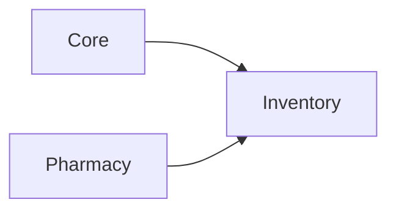

# Inventory module

> **Status:** Complete — see [Module Status](../../docs/shared/module-status.md). Verified against code on 2026-09-20. Sidebar: **Operations → Inventory** (`/inventory`).

**In one sentence:** The Inventory module manages central dispensary stock, procurement (purchase orders), ward/department requisitions, inter-branch stock transfers, and stock adjustments so the hospital can track, move, and replenish non-pharmacy supplies and equipment alongside pharmacy-mediated items.

## Why this module exists

Running a hospital requires more than just medicines. Supplies, consumables, and equipment also need to be tracked: where they are, who ordered them, when more should be ordered, and where they were sent. Without a dedicated inventory system, those workflows scatter across spreadsheets, paper forms, and silent shortages.

This module brings dispensary and ward-level stock into a single ledger, connects procurement to stock-on-hand, and tracks goods as they move between branches, departments, and the pharmacy.

## Where Inventory fits in FlowRise

- **Depends on Core** for branches, departments, units, and user/permission foundations.
- **Depends on Pharmacy** for the `Medication` catalog — inventory items can reference medications via `medication_id` for pharmacy-integrated stock.
- Provides its own stock ledger (`StockBalance`, `InventoryTransaction`) separate from Pharmacy's `StockItem`/`StockMovement`.
- Integrates with Pharmacy via Core's `StockProviderContract` (bound to Pharmacy `StockService`) so inventory issues to pharmacy update both ledgers atomically.

## What you can do with it

### Built (services + Filament)

- Maintain an **inventory item catalog** (supplies, consumables, equipment, general items) with optional medication linking and initial dispensary stock on create.
- Run several **named stores** per branch (General Stores, Medical Stores, Linen Store, ...) under **Inventory → Stores**. Each branch has one **main store** that receives purchase orders and transfers and serves requisitions by default. Requisitions can target a specific store and are issued only from that store's stock. Assign **store keepers** per store; once a store has keepers, only they (or users with `manage_all_stores`) can issue from it. The `store_keeper` role (Core `UserRole`) carries the stores permissions.
- Track **stock balances** across dispensary (store), ward, and in-transit locations per branch, including **lot tracking** with **FEFO** ledger decrement (expired lots are skipped on dispense/issue and can be written off through adjustments).
- Create and manage **purchase orders** — draft, submit, receive (partial quantities via modal), close.
- **Approve, decline, issue, or close** ward/department requisitions from Filament.
- **Issue counter** (Inventory → Issue counter): the storekeeper's queue of approved and backordered requisitions for their stores. **Issue items** hands over several lines at once, defaulting to what the store actually holds. Issuing less than owed needs a reason (out of stock, rationed, substituted, other) and a choice: **backorder** the rest or **close** it. The person collecting is recorded (staff member or typed name) and **draws a signature**, replacing the paper register (`INVENTORY_REQUIRE_COLLECTOR_SIGNATURE`, default on).
- **Ward confirmation**: the requester, the collector or the ward incharge confirms what arrived from the **Ward requisitions** widget, or disputes a shortfall with a note, which notifies the store's keepers. The requisition's **Hand-overs** tab and the **voucher PDF** show requested / approved / issued / closed / received quantities and each collector's signature.
- Run **inter-branch stock transfers** — create, ship, receive (partial), close with in-transit write-off.
- **Adjust stock** on any balance (Stock Balances → View → Adjust stock).
- View the **complete inventory ledger** and **analytics report** (8 chart widgets, CSV export).
- **Print documents** — GRN, Requisition Vouchers, Stock Transfer Notes, Adjustment Vouchers, and Stock Cards as PDF.
- **My ward requests** dashboard widget (lazy table, rendered after the Patient widgets) with slide-over create/view and fulfill shortcut.
- **Pharmacy → Stock Items → Request from central store** for medication-linked replenishment (only rendered when an active `InventoryItem` has that `medication_id` and pharmacy procurement is enabled).
- **Auto-reorder draft PO** generation from dispensary low stock.
- **Stock levels per store item**: a reorder point (minimum) and optional maximum level, set from **Set stock levels** on a stock balance or from the Stores dashboard. They apply to every lot of the item in that store. Suggested orders top up to the maximum level when one is set.
- **Instant low-stock alerts**: when an issue takes an item to or below its reorder point, that store's keepers (super admins if it has none) get an in-app notification. It fires once per drop, again if the item runs out, and resets once stock recovers (`INVENTORY_REALTIME_LOW_STOCK_ALERTS`, default on).
- **Scheduled stores digest** — `inventory:check-stock-alerts` (daily/weekly/monthly via Core `NotificationSettings`) sends each person one `InventoryReorderAlertNotification` covering the stores they keep: low-stock items plus lots that are expired or expire within `INVENTORY_EXPIRY_WARNING_DAYS` (default 60). Stores without keepers go to `super_admin` users.
- **Stock-takes** (Inventory → Stock-takes): start a count for a store, which snapshots every lot. Optionally make it a **blind count**, where counters don't see system quantities. Counts are entered inline on the count sheet, and stock found on the shelf can be added. Then submit, and a supervisor with `approve_stock_take` approves; it can't be the person who submitted, unless they have `manage_all_stores`. Approval posts each difference as a stock adjustment, all or nothing. Each count is compared with the stock on record when it is entered, so stores can keep issuing; enter paper counts promptly, because stock moved in between shows as a difference. Every difference needs a reason: on an open count before submitting, on a blind count from the approver. A count can be sent back for recount or cancelled. Printable **count sheet** and **variance report** PDFs.
- **Stores dashboard** (Inventory → Stores dashboard): out of stock, low stock, expiring and expired lots, requests waiting at the counter and backorders, and disputed hand-overs, filterable by store.

### Feature toggles

Enforced via `Feature::` in services and Filament navigation (`inventory_pharmacy_procurement`, `inventory_ward_requisitions`, `inventory_inter_branch_transfers`).

### Deferred

- FHIR SupplyDelivery (Phase 11 interoperability work).

## How it works (simple)

1. **Set up** your inventory catalog (items, suppliers, units, branches).
2. **Procure stock**: Create a purchase order → submit to supplier → receive goods → stock appears in dispensary (optionally by lot/expiry).
3. **Fulfill requests**: Ward staff request items via requisition (optionally choosing the store) → supervisor approves → the store's keeper issues stock from Filament.
4. **Move stock between sites**: Source branch ships → in-transit tracking → destination branch receives.
5. **Reconcile**: Run stock adjustments when physical count differs from system; review the transaction ledger.
6. **Stay ahead of shortages**: Enable reorder alerts under Administration → System → Notifications (Inventory section); use **Generate from low stock** on purchase orders when needed.

## What is inside this folder

| Path | Purpose |
|------|---------|
| `app/Models/` | 13 models including `DocumentSequence` for numbering. |
| `app/Classes/Services/` | Ledger (lot/FEFO), PO, requisition, transfer, adjustment, issue-to-ward/pharmacy, auto-reorder, analytics, consumption, PDF generators. |
| `app/Console/` | `CheckStockAlertsCommand` (`inventory:check-stock-alerts`). |
| `app/Filament/Clusters/Inventory/` | Admin UI: cluster, 7 resources, analytics report page, 8 chart widgets. |
| `app/Filament/Widgets/` | `MyWardRequestsWidget` for requestor dashboard. |
| `app/Enums/` | Item categories, stock location types, transaction types, status enums. |
| `app/Policies/` | Authorization rules (7 policies, Shield-standard permissions). |
| `app/Providers/` | Module boot/register logic and reorder-alert scheduler registration. |
| `database/migrations/` | 20 schema migrations (including lot tracking and stores). |
| `database/factories/` | 5 model factories. |
| `resources/views/pdf/` | Printable PDF templates. |
| `tests/` | 38 test files (run with `php artisan test Modules/Inventory/tests/ --compact`). |

## Dependencies

- `flowrise-hms/core`
- `flowrise-hms/pharmacy` (required in `module.json`; pharmacy procurement can be toggled off via `inventory_pharmacy_procurement`)

See [module status](../../docs/shared/module-status.md) for rollout state.

## Further reading

- **Developer guide:** [Inventory Developer Guide](docs/developer-guide.md)
- **Admin guide:** [Inventory Administration](../../docs/admin-guide/inventory.md)
- Project-level docs: [docs/README.md](../../docs/README.md)

## For developers

- **Namespace:** `Modules\Inventory\...`
- **Service provider:** `Modules\Inventory\Providers\InventoryServiceProvider`
- **Filament cluster:** `Modules\Inventory\Filament\Clusters\Inventory\InventoryCluster` (sidebar group Operations; resources use the in-cluster `NavigationGroup::CLINICAL` sub-group, the report page has none); resources InventoryItems, StockBalances, InventoryTransactions, Requisitions, PurchaseOrders, StockTransfers, Suppliers; page InventoryReport; dashboard widget `MyWardRequestsWidget`; exporter `StockBalanceExporter` (super admins)
- **Permissions:** Shield abilities per model plus `Approve Requisition`, `Issue Requisition`, `adjust_stock`; custom `print_inventory_document`, `download_inventory_document`, `view_inventory_report` (`config/config.php`); no seeder grants them to roles other than `super_admin`
- **Plugin:** `Modules\Inventory\Filament\InventoryPlugin`
- **Pharmacy bridge:** `IssueToPharmacyService` calls `StockProviderContract::incrementWithReference()`; Pharmacy binds the contract to `StockService` in `PharmacyServiceProvider`
- **Feature toggles:** `FeatureSettings` properties (`inventory_pharmacy_procurement`, `inventory_ward_requisitions`, `inventory_inter_branch_transfers`); enforced in services and Filament navigation via `Feature::`
- **Reorder alerts:** `NotificationSettings` (`inventory_reorder_alerts_enabled`, `inventory_reorder_alerts_frequency`); scheduled in `InventoryServiceProvider`
- **Document numbering:** `DocumentNumberingService` generates `PO-`, `REQ-`, `TRF-` prefixed numbers
- **Running tests:** `php artisan test --compact Modules/Inventory/tests` (38 test files; 20 migrations, 19 models, 8 factories, 10 policies)
- **REST API** (Api module, token scope `inventory`): items, suppliers, stock balances (`adjust`, needs `adjust_stock`; only main-store balances without lot, ward or transfer), stock transactions, purchase orders, requisitions (`approve`/`decline` need `Approve Requisition`; `endorse` is for the ward incharge; `cancel` for the requestor; issuing needs the signed hand-over and stays in the panel), stock transfers. See the [API Reference](../../docs/developer-guide/api-reference.md)
